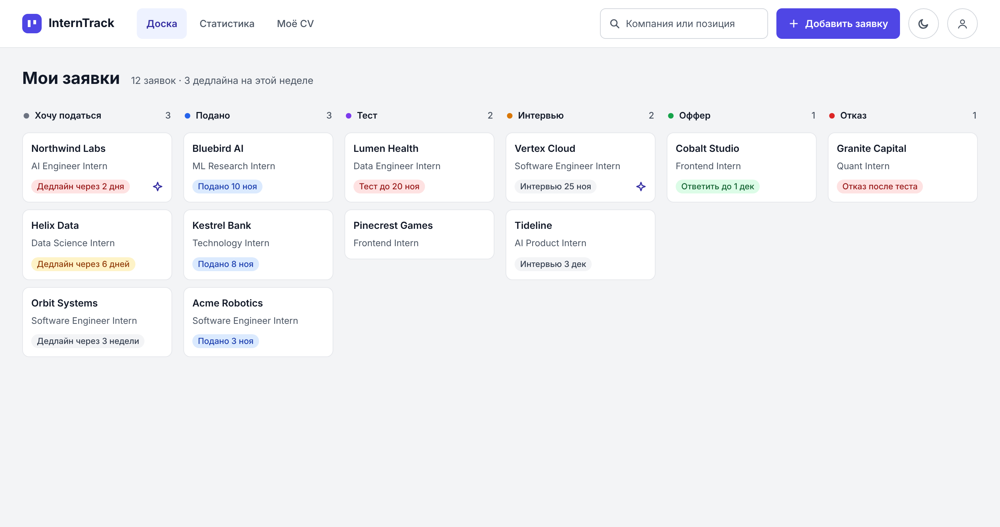
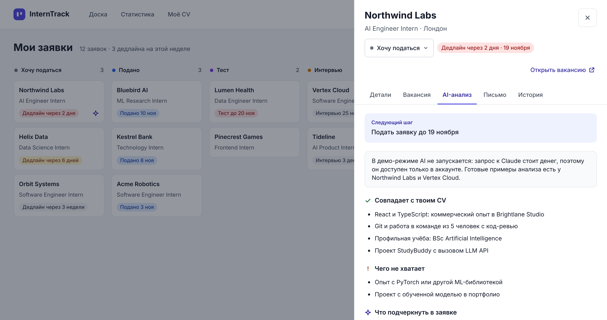
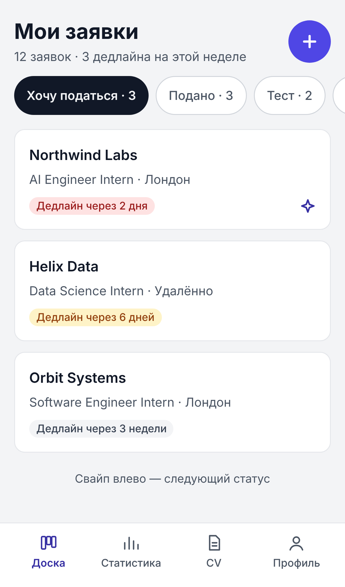
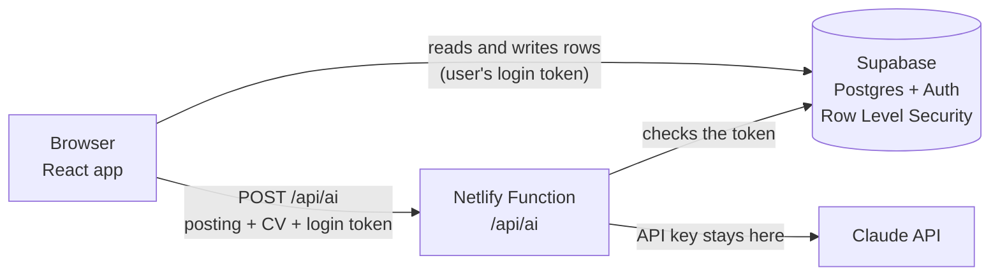

# InternTrack

Internship application tracker with AI job analysis.

Keep every internship application in one place, never miss a deadline, and
prepare applications faster: the AI compares a job posting with your CV and
drafts a cover letter. The interface is in Russian.



## Features

- **Kanban board.** Six columns: Wishlist → Applied → Test → Interview → Offer / Rejected.
  Drag a card to change its status; on a phone the columns become swipeable tabs.
- **Deadline highlighting.** Red within 3 days, yellow within a week. The badge text
  follows the stage: "Тест до 20 ноя", "Интервью 25 ноя", "Отказ после теста".
- **Application history.** Every status change is logged by the database itself,
  plus your own notes and the next step for each application.
- **AI analysis.** Paste the job posting and get what matches your CV, what is
  missing and what to emphasise.
- **Cover letter draft** for a specific posting, editable and saved.
- **Statistics.** Applications sent, reply rate, how far applications get, and the
  stage where rejections come.
- **Demo mode** with sample data, no sign-up needed. It runs entirely in the browser.
- Light and dark theme, installable on the home screen (PWA), keyboard and
  screen-reader friendly.

| AI analysis in the application panel | Phone layout |
| --- | --- |
|  |  |

## Tech stack

| Layer         | Technology                             |
| ------------- | -------------------------------------- |
| UI            | React 19, TypeScript, Vite             |
| Routing       | React Router                           |
| Styles        | Tailwind CSS 4 with design tokens      |
| Drag and drop | dnd-kit                                |
| Auth and data | Supabase (Postgres, Auth, RLS)         |
| AI server     | Netlify Functions (Node.js), Claude API |
| Validation    | zod (server)                           |
| Hosting       | Netlify                                |
| Tests         | Vitest; SQL checks on PostgreSQL       |

## Architecture



- The browser talks to Supabase directly. **Row Level Security** policies in the
  database make every query return only the signed-in user's rows, whatever the
  client sends.
- AI requests go through a **server function**: it verifies the user's Supabase
  token, validates the input and is the only place that holds the Claude API key.
- The app code depends on a small `Repository` interface with two implementations:
  Supabase for real accounts and `localStorage` for the demo.

## Getting started

Requires Node.js 22 or newer.

```bash
git clone https://github.com/Denchik509/interntrack.git
cd interntrack
npm install
npm run dev
```

Open the printed address and choose **"Открыть демо без регистрации"**: the demo
works without any accounts or keys.

### Real accounts with Supabase

1. Create a project at [supabase.com](https://supabase.com).
2. In **SQL Editor**, run [`supabase/migrations/20261117000000_initial_schema.sql`](supabase/migrations/20261117000000_initial_schema.sql).
3. Copy `.env.example` to `.env` and fill in `VITE_SUPABASE_URL` and
   `VITE_SUPABASE_ANON_KEY` (Project Settings → API).
4. In **Authentication → URL Configuration**, set the Site URL to your local or
   deployed address, so confirmation emails link back to the app.

### AI features

The AI runs in the Netlify Function, so `npm run dev` alone does not serve it.

1. Get an API key at [console.anthropic.com](https://console.anthropic.com) and add
   `ANTHROPIC_API_KEY` to `.env`.
2. Run the app with the Netlify CLI, which serves both the app and `/api/ai`:

   ```bash
   npm install -g netlify-cli
   netlify dev
   ```

The model defaults to `claude-opus-5-5`; set `ANTHROPIC_MODEL` to use another one.

### Deploy to Netlify

1. Import the GitHub repository in Netlify. `netlify.toml` already sets the build
   command, the output folder, the SPA fallback and the functions folder.
2. In **Site configuration → Environment variables**, add `VITE_SUPABASE_URL`,
   `VITE_SUPABASE_ANON_KEY` and `ANTHROPIC_API_KEY`.
3. Add the Netlify address to the Supabase Site URL.

## Scripts

| Command              | What it does                        |
| -------------------- | ----------------------------------- |
| `npm run dev`        | Start the local dev server          |
| `npm run build`      | Type-check and build for production |
| `npm run preview`    | Serve the production build locally  |
| `npm run test`       | Run the unit tests once             |
| `npm run test:watch` | Re-run the tests on every change    |
| `npm run lint`       | Lint the code with oxlint           |

## Tests

- **Unit tests** (`npm run test`): deadline and badge rules, Russian date and plural
  formatting, statistics, the demo repository, and the AI server function. The
  function is tested with fake dependencies and a fake `fetch` that checks the exact
  request sent to the Claude API, so the tests need no network or keys.
- **Database checks** (`supabase/tests`): apply the migration to a local PostgreSQL
  with a small Supabase stand-in and verify that a second user can neither read nor
  change the first user's applications, history, CV or AI results:

  ```bash
  PGHOST=localhost PGUSER=postgres supabase/tests/run.sh
  ```

## Project structure

```
src/
  pages/         screens: board, application panel, stats, CV, profile, sign-in
  components/    UI pieces: board columns and cards, panel tabs, form fields
  state/         TrackerProvider (all data + actions), AI actions hook
  data/          Repository interface, Supabase and demo implementations
  lib/           plain logic: dates, deadlines, statuses, statistics
  auth/          sign-in state (Supabase or demo)
server/ai/       AI request handler, prompts, Claude client
netlify/functions/ai.ts   the serverless function at /api/ai
supabase/        SQL migration and RLS checks
```

## Roadmap

- [x] 0. Setup: Vite, React, TypeScript, Tailwind, Vitest, Netlify config
- [x] 1. Auth and database: tables, Row Level Security, sign-in, demo mode
- [x] 2. Applications: create, edit, delete
- [x] 3. Kanban board with drag and drop
- [x] 4. Application panel, history and deadline highlighting
- [x] 5. AI: server function, job analysis, cover letter draft
- [x] 6. Statistics
- [x] 7. Polish: phone layout, PWA, dark theme, empty states, tests

Next ideas: email reminders 3 days before a deadline, several CV versions,
calendar export, interview preparation questions, a browser extension to save a
posting in one click.
