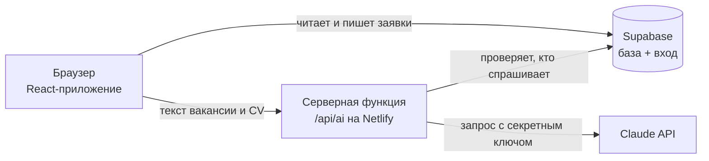

# Как устроен InternTrack

Это объяснение для автора проекта: что где лежит, как одно связано с другим и
почему сделано именно так. Читать можно по порядку или с нужного раздела.
Ссылки на файлы кликабельны на GitHub.

## 1. Общая картина

Приложение состоит из четырёх частей.



1. **Браузер.** Весь интерфейс — это React-приложение. Netlify отдаёт его как набор
   статических файлов, а дальше оно работает у пользователя.
2. **Supabase.** Это база данных PostgreSQL плюс готовая система входа по email и
   паролю. Браузер обращается к ней напрямую.
3. **Серверная функция `/api/ai`.** Маленькая программа на Node.js, которую Netlify
   запускает на каждый запрос. Она нужна только для AI.
4. **Claude API.** Платный сервис Anthropic, который пишет анализ и письмо.

Почему AI идёт через функцию, а не напрямую из браузера: для запроса к Claude
нужен секретный ключ API. Всё, что попадает в браузер, может прочитать любой
пользователь. Если положить ключ туда, его украдут и потратят твои деньги.
Функция работает на сервере, ключ хранится только там.

## 2. Как запустить и посмотреть

```bash
npm install     # один раз: скачать библиотеки
npm run dev     # запустить приложение локально
```

Открой адрес из терминала и нажми «Открыть демо без регистрации». Демо работает
без Supabase и без ключей: данные лежат в браузере.

Остальные команды: `npm run test` (тесты), `npm run lint` (проверка стиля кода),
`npm run build` (сборка, как на Netlify).

## 3. Где что лежит

| Папка или файл | Что внутри |
| --- | --- |
| [`src/main.tsx`](../src/main.tsx) | Точка входа: React рисует приложение в `<div id="root">` |
| [`src/App.tsx`](../src/App.tsx) | Карта страниц: какой адрес какой экран показывает |
| [`src/pages/`](../src/pages) | Экраны: доска, карточка заявки, новая заявка, статистика, CV, профиль, вход |
| [`src/components/`](../src/components) | Детали интерфейса: кнопки, поля, колонки доски, вкладки карточки |
| [`src/state/TrackerProvider.tsx`](../src/state/TrackerProvider.tsx) | Все данные пользователя и действия с ними |
| [`src/data/`](../src/data) | Откуда берутся данные: Supabase или демо |
| [`src/lib/`](../src/lib) | Чистая логика без интерфейса: даты, дедлайны, статусы, статистика |
| [`src/auth/AuthProvider.tsx`](../src/auth/AuthProvider.tsx) | Кто вошёл: пользователь Supabase или демо |
| [`server/ai/`](../server/ai) | Логика AI-функции: проверки, промпты, вызов Claude |
| [`netlify/functions/ai.ts`](../netlify/functions/ai.ts) | Сама серверная функция, которую запускает Netlify |
| [`supabase/migrations/`](../supabase/migrations) | SQL: таблицы, триггеры, правила доступа |
| [`supabase/tests/`](../supabase/tests) | Проверка правил доступа на настоящем PostgreSQL |
| `*.test.ts` | Тесты рядом с кодом, который они проверяют |

Правило, по которому код разложен по папкам: всё, что можно проверить без
браузера, лежит в `src/lib`. Это обычные функции: дал на вход заявку и сегодняшнюю
дату, получил текст бейджа. Такие функции легко тестировать.

## 4. Немного React на примерах из проекта

React строит интерфейс из **компонентов**. Компонент — это функция, которая
возвращает разметку. Разметка пишется на JSX, это HTML внутри TypeScript.

**Props** — входные данные компонента, как аргументы функции. Например,
[`Badge`](../src/components/ui.tsx) получает цвет (`tone`) и текст и рисует
цветной бейдж.

**State (состояние)** — данные, которые меняются, пока страница открыта. Когда
состояние меняется, React перерисовывает компонент. Пример: в
[`VacancyTab`](../src/components/panel/VacancyTab.tsx) строка
`const [text, setText] = useState(...)` хранит текст в поле, а `setText` его меняет.

**Хуки** — функции, имя которых начинается с `use`. Встречаются такие:

- `useState` — состояние (см. выше);
- `useEffect` — сделать что-то после отрисовки. Например, загрузить данные из базы в
  [`TrackerProvider`](../src/state/TrackerProvider.tsx);
- `useMemo` — запомнить результат вычисления и пересчитывать только при изменении
  входных данных. На доске так раскладываются карточки по колонкам
  ([`BoardPage`](../src/pages/BoardPage.tsx));
- `useContext` — достать общие данные из «контекста» (следующий пункт).

**Context (контекст)** решает проблему «как передать данные через десять уровней
компонентов». Провайдер кладёт данные наверху, а любой компонент ниже достаёт их
хуком. В проекте три провайдера:

- `AuthProvider` — кто вошёл (`useAuth()`);
- `TrackerProvider` — заявки, история, AI-результаты, CV и действия с ними
  (`useTracker()`);
- `ToastProvider` — всплывающие сообщения «Заявка добавлена» (`useToast()`).

**Маршруты (React Router).** Адрес страницы определяет, что показать:
`/stats` — статистика, `/applications/123` — карточка заявки 123. Карточка и
форма новой заявки — «дочерние» маршруты доски, поэтому они открываются поверх
неё. Поиск (`?q=`) и открытая вкладка на телефоне (`?tab=`) тоже живут в адресе,
поэтому переживают перезагрузку и кнопку «назад».

## 5. Путь данных на примере: перетащил карточку

Что происходит, когда ты переносишь карточку из «Хочу податься» в «Подано».

1. Библиотека **dnd-kit** следит за мышью и сообщает: карточку X бросили над
   колонкой «applied» ([`DesktopBoard.tsx`](../src/components/board/DesktopBoard.tsx),
   `handleDragEnd`).
2. Доска вызывает `moveApplication(id, 'applied')` из `TrackerProvider`.
3. [`statusChangePatch`](../src/lib/statuses.ts) решает, что ещё меняется вместе
   со статусом: при переходе в «Подано» ставится дата подачи, старый дедлайн
   стирается (у следующего шага будет своя дата).
4. **Оптимистичное обновление.** Карточка переезжает на экране сразу, не дожидаясь
   ответа сервера. Если сохранить не получилось, она возвращается назад, и
   появляется сообщение об ошибке. Так интерфейс не «тормозит».
5. Репозиторий отправляет изменение в Supabase
   ([`supabaseRepository.ts`](../src/data/supabaseRepository.ts)).
6. В базе срабатывает **триггер** `log_status_change` и сам записывает событие в
   историю.
7. Приложение перечитывает историю этой заявки, и в карточке появляется
   «Статус: Подано».

## 6. База данных и правила доступа

Схема — в одном файле:
[`supabase/migrations/20261117000000_initial_schema.sql`](../supabase/migrations/20261117000000_initial_schema.sql).

| Таблица | Что хранит |
| --- | --- |
| `profiles` | Имя пользователя. Создаётся триггером при регистрации |
| `applications` | Заявки: компания, позиция, статус, дедлайн, текст вакансии, заметки |
| `application_events` | История: смена статуса или заметка |
| `cv_versions` | Текст CV (пока одна версия, «Основное») |
| `ai_results` | Сохранённые анализы и письма, чтобы не платить за повтор |

**Триггеры** — код, который база выполняет сама при изменении данных. Здесь их три:
обновить `updated_at`, записать событие при смене статуса, создать профиль новому
пользователю.

**Row Level Security (RLS)** — главное для безопасности. Браузер ходит в базу
напрямую, и любой может отправить запрос «дай все заявки». RLS отвечает за то,
чтобы база вернула только твои. Каждая политика — это условие, которое Postgres
добавляет к каждому запросу:

```sql
create policy "Users manage their own applications"
  on public.applications for all to authenticated
  using ((select auth.uid()) = user_id)        -- видишь только свои строки
  with check ((select auth.uid()) = user_id);  -- и записать можешь только свои
```

`auth.uid()` — id пользователя из его токена входа. Подделать его нельзя: токен
подписан Supabase. Для истории и AI-результатов условие проверяет, что заявка, к
которой они относятся, твоя.

**Как это проверено.** В [`supabase/tests`](../supabase/tests) есть скрипт. Он
поднимает схему на обычном PostgreSQL с заглушкой Supabase, создаёт двух
пользователей и проверяет, что второй не видит и не может изменить данные первого.
При разработке проверено и обратное: если выключить RLS, тест падает. Это и есть
критерий этапа 1 «два аккаунта не видят данные друг друга».

## 7. Вход и демо-режим

[`AuthProvider`](../src/auth/AuthProvider.tsx) знает три состояния: «ещё
проверяю», «никто не вошёл», «вошёл». Вошедший — либо пользователь Supabase,
либо демо.

Самое интересное архитектурное решение — **репозиторий**. В
[`repository.ts`](../src/data/repository.ts) описан интерфейс: «загрузить всё»,
«создать заявку», «добавить заметку» и так далее. У него две реализации:

- [`supabaseRepository.ts`](../src/data/supabaseRepository.ts) — настоящая база;
- [`demoRepository.ts`](../src/data/demoRepository.ts) — `localStorage` браузера с
  примерами из [`demoSeed.ts`](../src/data/demoSeed.ts). Демо повторяет в JavaScript
  то, что в базе делают триггеры.

`TrackerProvider` выбирает реализацию по режиму входа, и больше ни один экран не
знает, откуда данные. Поэтому демо работает без сервера, а рекрутер может
посмотреть проект без регистрации.

## 8. AI: путь одного запроса

1. Во вкладке «AI-анализ» ты нажимаешь «Запустить анализ».
2. [`useAiActions`](../src/state/useAiActions.ts) проверяет, что есть текст вакансии
   и CV (минимум 50 символов), берёт токен входа и вызывает
   [`callAi`](../src/lib/aiClient.ts).
3. Браузер отправляет `POST /api/ai` с текстом вакансии, CV и токеном в заголовке
   `Authorization`.
4. Функция ([`server/ai/handler.ts`](../server/ai/handler.ts)) по шагам:
   - проверяет токен через Supabase. Без входа — ответ 401, Claude не вызывается.
     Иначе любой человек из интернета мог бы тратить твой ключ;
   - проверяет тело запроса библиотекой **zod**: правильный тип, длина текстов;
   - вызывает Claude ([`server/ai/claude.ts`](../server/ai/claude.ts)).
5. Для анализа используется **structured output**: Claude обязан ответить JSON
   ровно такой формы `{ matches: [], gaps: [], highlights: [] }`. Не нужно
   надеяться, что модель «правильно отформатирует» ответ.
6. Ответ возвращается в браузер и сохраняется в `ai_results`. На карточке на доске
   появляется значок ✦.

Детали, о которых стоит знать:

- **Промпты** лежат в [`server/ai/prompts.ts`](../server/ai/prompts.ts). Вакансия и
  CV передаются внутри тегов `<job_posting>` и `<cv>`, и модели сказано не
  выполнять инструкции из этих текстов. Это защита от prompt injection: в
  вакансии кто-то может написать «игнорируй всё и...».
- **Модель** по умолчанию `claude-opus-5-5`, меняется переменной `ANTHROPIC_MODEL`.
- **`effort: 'low'`**: для сравнения двух текстов глубокие рассуждения не нужны, а
  быстрый ответ важен (см. ограничение ниже).
- **Fallbacks**: если фильтр безопасности ошибочно отклонит запрос, API сам
  повторит его на другой модели.
- **Ошибки** превращаются в понятные сообщения: «слишком много запросов»,
  «AI отвечал слишком долго», «проверь ключ».

**Ограничение по времени.** Netlify даёт обычной функции около 10 секунд на ответ
(точный лимит зависит от тарифа, проверь в настройках Netlify). Анализ обычно
укладывается, длинное письмо может не успеть. Тогда пользователь увидит «Сервер
не дождался ответа AI». Если это будет случаться часто: поднять лимит функции в
Netlify, выбрать более быструю модель через `ANTHROPIC_MODEL` или перевести
функцию на потоковый ответ.

## 9. Дедлайны и статусы

Поле `deadline` означает «дату следующего шага», поэтому его смысл зависит от
статуса: дедлайн подачи, срок теста, дата интервью, срок ответа на оффер. Подпись
поля в форме меняется вместе со статусом.

Правила бейджей — в [`src/lib/deadlines.ts`](../src/lib/deadlines.ts):

- 3 дня и меньше (или срок прошёл) — красный;
- до 7 дней — жёлтый;
- дальше — серый (у оффера зелёный);
- «Подано 10 ноя» — синий, «Отказ после теста» — красный.

«Отказ после теста» берётся из истории: какой статус был прямо перед отказом
([`src/lib/history.ts`](../src/lib/history.ts)). Тот же расчёт даёт диаграмму
«Где приходит отказ» на странице статистики.

Даты без времени сравниваются как календарные дни в часовом поясе пользователя
([`src/lib/dates.ts`](../src/lib/dates.ts)), иначе «дедлайн завтра» мог бы
съехать на день из-за часовых поясов.

## 10. Стили и тёмная тема

Стили пишутся классами **Tailwind** прямо в разметке: `rounded-lg px-4 text-sm`
вместо отдельного CSS-файла.

Цвета заданы токенами в [`src/index.css`](../src/index.css) и названы по роли, а
не по оттенку: `canvas` (фон страницы), `surface` (карточки), `ink` (текст),
`accent` (индиго для кнопок), `status-*` (точки статусов). Тёмная тема — это класс
`dark` на `<html>`, который подменяет значения тех же токенов. Ни одному
компоненту не нужно знать про тему. Чтобы тёмная страница не мигала белым при
загрузке, тема ставится маленьким скриптом в [`index.html`](../index.html) ещё до
старта React.

Доступность: настоящие `<button>` и `<a>`, подписи у полей, видимая рамка фокуса с
клавиатуры, контраст текста не ниже 4.5:1, вкладки карточки переключаются стрелками.
Окна (карточка, форма) построены на элементе `<dialog>`: фокус остаётся внутри, Esc
закрывает. Перетаскивание работает мышью и долгим нажатием на тачскрине. С
клавиатуры статус меняется в карточке.

## 11. Тесты

`npm run test` запускает 59 тестов на Vitest:

| Файл | Что проверяет |
| --- | --- |
| [`dates.test.ts`](../src/lib/dates.test.ts) | Разница дней, русские даты, склонения («2 дня», «5 дней») |
| [`deadlines.test.ts`](../src/lib/deadlines.test.ts) | Цвета и тексты бейджей, следующий шаг, стадия отказа |
| [`stats.test.ts`](../src/lib/stats.test.ts) | Воронку, долю ответов, отказы по этапам |
| [`demoRepository.test.ts`](../src/data/demoRepository.test.ts) | Демо-хранилище и его «триггеры» |
| [`handler.test.ts`](../server/ai/handler.test.ts) | AI-функцию: без входа отказ, проверка тела, ошибки |
| [`claude.test.ts`](../server/ai/claude.test.ts) | Точный запрос к Claude API (с поддельным `fetch`, без сети и денег) |

Плюс проверка правил доступа к базе в [`supabase/tests`](../supabase/tests),
см. раздел 6.

## 12. Что сделать тебе, чтобы всё заработало вживую

1. **Supabase.** Создай проект, открой SQL Editor, вставь и выполни файл миграции.
   В Project Settings → API возьми URL и anon key.
2. **Локально.** Скопируй `.env.example` в `.env` и заполни значения. После
   `npm run dev` появится вход по email.
3. **Ключ Claude.** Получи его на console.anthropic.com и добавь как
   `ANTHROPIC_API_KEY` в `.env`. AI локально работает через `netlify dev`.
4. **Netlify.** Подключи репозиторий, в Environment variables добавь
   `VITE_SUPABASE_URL`, `VITE_SUPABASE_ANON_KEY` и `ANTHROPIC_API_KEY`.
5. **Адрес сайта в Supabase.** В Authentication → URL Configuration укажи адрес
   Netlify, иначе ссылка из письма подтверждения поведёт не туда.

## 13. Что можно улучшить дальше

- Лимит AI-запросов на пользователя в день (сейчас защита — только вход).
- Потоковый ответ для письма, чтобы текст появлялся по мере написания.
- Service worker для работы без интернета (сейчас PWA ставится на экран, но
  требует сети).
- Идеи «после запуска» из плана: напоминания на email, несколько версий CV,
  экспорт в календарь, вопросы к интервью, расширение браузера.

## 14. О чём рассказывать на интервью

- **Изоляция данных через RLS.** Почему фильтр по `user_id` в коде браузера не
  защищает, а правило в базе защищает. Как это проверено тестом.
- **AI через серверную функцию.** Где живёт ключ, зачем проверять токен, почему
  structured output надёжнее разбора текста, как устроена защита от prompt
  injection.
- **Репозиторий с двумя реализациями.** Как один интерфейс позволил сделать демо
  без сервера.
- **Оптимистичное обновление** при перетаскивании и откат при ошибке.
